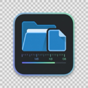

<div align="center">
  
  <h1>Size Peek</h1>
  <p><strong>How big is that folder? Right-click and find out.</strong></p>
  <p>File and folder sizes, right inside the VS Code Explorer.<br />Local projects and Remote-SSH workspaces. English and 简体中文.</p>
</div>

---

Checking a build output, a dataset, or a growing `node_modules` folder? **Size Peek** puts the answer where you're already working.

Right-click a file or folder, choose **Show Size**, and see its size in a notification. For folders, you also get file and directory counts.

**Explorer → Right-click → Show Size**

Example results:

```text
dist: 12.3 MB (48 files, 6 directories)
training-data: 2.4 GB (1200 files, 8 directories)
```

*Illustrative values. Your results reflect the files that can be read in the selected location.*

## A small tool for everyday questions

| When you're wondering… | Use Size Peek to… |
| --- | --- |
| “How large is this build?” | Check your output folder before sharing or deploying it. |
| “How much data is in here?” | Get the total file size and counts for a dataset or asset directory. |
| “How big is that folder on the server?” | Inspect it directly from a Remote-SSH workspace. |

- **Stay in the Explorer.** View sizes in a notification without copying paths or running a shell command.
- **Follow the scan.** File counts and size update as a folder is scanned. Cancel when you have what you need.
- **Know when a total is incomplete.** Unreadable entries produce a partial-size warning with a skipped-entry count.
- **Use it in your language.** Commands and notifications support English and Simplified Chinese.

## Get started

Requires **VS Code 1.85 or later**.

Install **Size Peek** by **KennyXiao** from the Extensions view. If you have a `.vsix` package, open the Extensions view's **…** menu, choose **Install from VSIX…**, and select the package.

1. Open the **Explorer** in VS Code.
2. Right-click a file or folder.
3. Select **Show Size** — or **查看大小** in Simplified Chinese.
4. Read the result in the notification. For a longer scan, watch the progress or select **Cancel**.

## Working over SSH?

Connect with **Remote-SSH**, open your remote folder, and use **Show Size** from the Explorer as usual. Install Size Peek in the SSH workspace when VS Code prompts you.

The scan runs in the workspace extension host and uses the remote filesystem, so the result describes the files on your server. No Size Peek configuration is required.

## What the numbers mean

Size Peek adds up **file sizes** within the selected folder, including nested folders. It does not measure allocated disk space or the free space on a drive. Units use powers of 1024 and are displayed as B, KB, MB, and so on.

| Result | Meaning |
| --- | --- |
| Normal size notification | The scan completed without unreadable entries. Symbolic links are intentionally excluded. |
| **Partial size** warning | Some entries could not be read. The displayed total includes only readable files. |
| Error notification | The selected file or folder itself could not be read. |

A few details:

- **Symbolic links are skipped** to avoid following cycles or counting linked targets again.
- **Counts include successfully scanned entries.** The directory count excludes the folder you selected. An unreadable subtree counts as one skipped entry because its contents are unknown.
- **Large folders take time.** You can cancel a scan; a pending filesystem operation must finish before cancellation takes effect. No result is displayed after cancellation.

## Develop and build

```bash
npm ci
npm test
npm run typecheck
npm run compile
```

Press **F5** in VS Code to launch an Extension Development Host and try the command.

To create an installable package:

```bash
npm run package
```

Packaging automatically checks types and compiles the current source before creating the `.vsix`.

The extension uses `vscode.workspace.fs` for filesystem access. Size calculation is isolated from the editor API and tested with an in-memory filesystem; command tests cover notifications and localization through a mocked VS Code boundary.

## Feedback

Found an issue or have a suggestion? [Open an issue on GitHub](https://github.com/Xiao-VoV/vscode_file_size/issues). For scan problems, include whether you're working locally or over Remote-SSH, the selected entry type, and any error message.

## License

[MIT](LICENSE)
